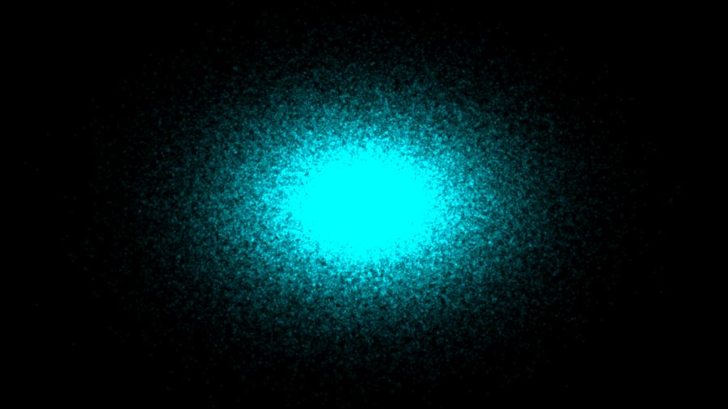

# TDCuda — GPU Particle Cloud for TouchDesigner




A GPU-resident 3D particle cloud for [TouchDesigner](https://derivative.ca),
driven by a custom **CUDA** operator. The simulation runs as a CUDA kernel
with persistent position **and velocity** buffers (a stateful force-field /
light N-body sim), writes particle positions into an `RGBA32F` texture, and a
GLSL material reads that texture to draw each particle as a camera-facing
billboard sprite. Nothing round-trips through the CPU.

```
 ParticleCloudTOP.dll  (CPlusPlus TOP, CUDA execute mode)
   pos[i], vel[i] persist on the GPU; integrate a force field each frame
        │
        ▼  writes RGBA32F  texel = (x, y, z, life)
   position texture ──────────────┐  bound as sampler 'sPos'
                                   ▼
   GLSL MAT vertex shader: texelFetch(TDInstanceID()) places one
   instanced billboard quad per particle, sized by uSprite, tinted by uColor
        │
        ▼
   Render TOP ──▶ Blur ──▶ additive Composite (bloom) ──▶ out
```

The force field is **O(N)** per frame (central gravity well + swirl +
turbulence + damping), not an O(N²) all-pairs gravity — that would need
tiling / Barnes-Hut and is a natural next step.

## Repository layout

| File | Purpose |
|------|---------|
| `ParticleCloudTOP.cu` | The custom operator: CUDA kernels (init + integrate) and the TouchDesigner `CPlusPlus TOP` plugin glue. |
| `CMakeLists.txt` | Build configuration. Targets `sm_89` (RTX 40-series / Ada) with fast-math. |
| `build.bat` | One-click Windows build (selects CUDA 12.8 + the TD headers). |
| `build_particle_cloud_cuda.py` | Builds the whole TD network (CUDA TOP, GLSL material, geometry, camera, bloom) and exposes its controls, when run inside TouchDesigner. |
| `ParticleCloudCUDA.tox` | Prebuilt component — drag into any project, then point the inner CUDA TOP's Plugin Path at your built DLL. |
| `.github/workflows/compile.yml` | CI that compiles the operator on every push (drives the badge above). |

## Prerequisites (local build, Windows)

- **Visual Studio 2022** with the "Desktop development with C++" workload.
- **CUDA Toolkit** matching your TouchDesigner build's **major** version.
  TouchDesigner 2025.x bundles CUDA 12.x; this project builds against **12.8**.
  A plugin built with any CUDA 12.x links the major-versioned
  `cudart64_12.dll`, so it runs against TD's 12.8 **or** 12.9 runtime.
  See the [CUDA version table](https://docs.derivative.ca/CUDA).
- The **TouchDesigner C++ API headers** (`TOP_CPlusPlusBase.h`,
  `CPlusPlus_Common.h`, …). These ship inside your TouchDesigner install with
  the bundled **CudaTOP** sample, e.g.
  `…/TouchDesigner/Samples/CPlusPlus/CudaTOP/`. They are *not* committed here
  (they belong to Derivative); point the build at your local copy.

## Build

```bat
:: Edit build.bat if your CUDA / TD paths differ, then just:
build.bat
```

…or drive CMake directly (Ninja shown; a VS generator also works):

```bat
cmake -B build -G Ninja -DCMAKE_BUILD_TYPE=Release ^
  -DCMAKE_CUDA_FLAGS="-allow-unsupported-compiler -D_ALLOW_COMPILER_AND_STL_VERSION_MISMATCH" ^
  -DTD_INCLUDE="C:/Program Files/Derivative/TouchDesigner/Samples/CPlusPlus/CudaTOP"
cmake --build build --config Release
```

Output: `build/Release/ParticleCloudTOP.dll` (VS) or
`build/ParticleCloudTOP.dll` (Ninja).

> **Host compiler note:** recent MSVC toolsets are newer than older CUDA
> toolkits officially list. The `-allow-unsupported-compiler` flag (already in
> `CMakeLists.txt`) relaxes that gate; CUDA 12.8 + VS 2022 compiles cleanly.

## Installing and using the operator (it is a **TOP**)

`ParticleCloudTOP` is a **TOP**: it outputs a 2D `RGBA32F` texture that is a
*data buffer*, not a picture — each texel holds one particle's
`(x, y, z, life)`. You don't view it directly; you feed it to a GLSL material
that instances geometry (the builder below wires this up for you). There are
two ways to load the DLL.

### A. As a CPlusPlus TOP (plugin path) — no install

This is what `build_particle_cloud_cuda.py` does, and the quickest way to try
it:

1. Create a **CPlusPlus TOP**.
2. Set its **Plugin Path** parameter to your built `ParticleCloudTOP.dll`.
3. Custom parameters (Count, Radius, Gravity, …) appear on the TOP's
   **Custom** page.

### B. As an installed Custom Operator — a native TOP in the OP menu

Because the plugin declares an op type, you can drop the DLL into a **Plugins
folder** and TouchDesigner will load it at startup as a first-class operator:

1. Copy `ParticleCloudTOP.dll` into one of TD's plugin search folders:
   - `…/<the folder next to your .toe>/Plugins/`, or
   - `%USERPROFILE%/Documents/Derivative/Plugins/` (all projects), or
   - any folder listed in the `TOUCH_PLUGIN_PATH` environment variable.
2. Restart TouchDesigner.
3. In a network press **Tab** → **TOP** → **Custom** category → **“Particle
   Cloud CUDA”** (op type `particlecloudcuda`). The first time, TD asks you to
   confirm loading a third-party binary.

> The DLL must be built against the **same CUDA major version** as the target
> TouchDesigner (12.x for 2025.x) and against the TD C++ API (2022.20000+
> headers). A mismatch shows up as "loads but won't cook."

## Run the full component in TouchDesigner

To build the complete, pre-wired, GUI-controllable component:

1. Build the DLL (above).
2. Open `build_particle_cloud_cuda.py` and set `DLL_PATH` to your built DLL.
3. In TouchDesigner, create a **Text DAT**, paste the script in, right-click →
   **Run Script**.
4. Open `/particle_cloud_cuda` and view the `out` TOP.

Or skip the script: drag **`ParticleCloudCUDA.tox`** into your network and set
the inner `cuda_particles` TOP's **Plugin Path** to your built DLL.

## Controls

Running the builder adds a **“Particle Cloud”** custom parameter page to the
`/particle_cloud_cuda` COMP, so the whole thing is controllable from the
component's parameter dialog (and bindable/keyframable at runtime). Each
control is bound to the operator it drives:

| Parameter | Drives | Meaning |
|-----------|--------|---------|
| **Render Mode** | geometry switch | `Billboard quad` (robust) or `Triangle sprite` (lighter geometry for 1M+). Switches live. |
| **Particle Count** | CUDA TOP + instance count | Number of particles (buffers reallocate on change). |
| **Cloud Radius** | CUDA TOP | Size of the initial gaussian blob. |
| **Speed** | CUDA TOP | Time-step multiplier for the integration. |
| **Gravity (+pull / -push)** | CUDA TOP | Central force. **Positive** pulls particles toward the origin (a well); **0** lets swirl/turbulence carry them; **negative pushes them outward** (repulsion / explosion). |
| **Swirl** | CUDA TOP | Tangential force — orbital motion around Y. |
| **Damping** | CUDA TOP | Velocity retained per frame (lower = more drag). |
| **Turbulence** | CUDA TOP | Strength of the sinusoidal flow field. |
| **Reset** | CUDA TOP (pulse) | Re-seed positions and velocities. |
| **Color Mode** | GLSL (per-particle) | `Single color` (every particle uses **Color**) or `Many colors` (each particle gets its own random hue from a hash of its ID). |
| **Color** | GLSL `uColor` | Particle color (RGB), used in **Single color** mode. |
| **Sprite Size** | GLSL `uSprite` | World-space size of each sprite (both modes). |
| **Glow Intensity** | GLSL `uColor.a` | Per-particle brightness; additive blending accumulates it into a bright core. |
| **Camera Distance** | Camera `tz` | Pull the camera in/out. |
| **Bloom** | Blur size | Strength of the neon glow. |

(The CUDA TOP keeps its own Custom page too, if you load it standalone via
method A/B above.)

### Render modes — and why not true GL point sprites

Both modes read the **same** CUDA position texture; only the instanced
primitive and its GLSL shader differ, and the **Render Mode** menu flips
between them live (each geometry renders only in its own mode, so there is no
double cost):

| Mode | Primitive / particle | Notes |
|------|----------------------|-------|
| **Billboard quad** (default) | 4 verts, 2 tris | Robust, edge-safe, big well-behaved sprites. |
| **Triangle sprite** | 3 verts, 1 tri | ~25% fewer verts / 50% fewer tris → more headroom toward 1M+ when vertex/primitive-bound. The round dot is carved from the triangle in the fragment shader. |

There is deliberately **no literal `GL_POINTS` mode**: TouchDesigner's Render
TOP rasterizes *primitives* (polys/lines) and offers no `gl_PointSize` path —
a points-only SOP renders nothing, with or without instancing (verified). So
the cheapest *renderable* one-primitive sprite TD supports is a single
triangle, and that is the practical substitute for GL point sprites at scale.

## Continuous integration

`.github/workflows/compile.yml` compiles the operator on every push using a
Windows runner: it installs a CUDA 12.x toolkit, fetches the TD C++ API
headers from Derivative's public **CustomOperatorSamples** repo, and builds
with CMake + Ninja. The badge at the top reflects the latest run.

## Roadmap

- ~~True GL point sprites for 1M+ particles~~ — added as the **Triangle sprite**
  render mode (TD can't rasterize loose `GL_POINTS`; a single instanced
  triangle is the cheapest renderable sprite — see *Render modes* above).
- Per-particle color by speed / age via extra texture channels.
- All-pairs or Barnes-Hut gravity for real N-body behaviour.

## License

The source in this repository is provided as-is for use with TouchDesigner.
The TouchDesigner C++ API headers are © Derivative Inc. and are **not**
included here — obtain them from your TouchDesigner installation.
